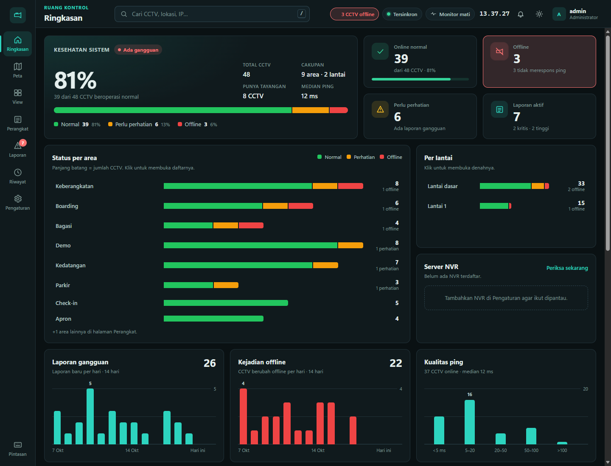
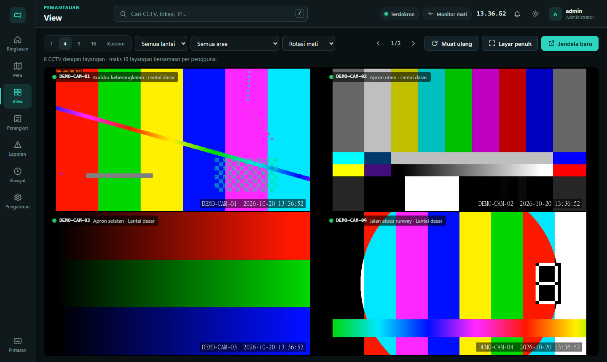
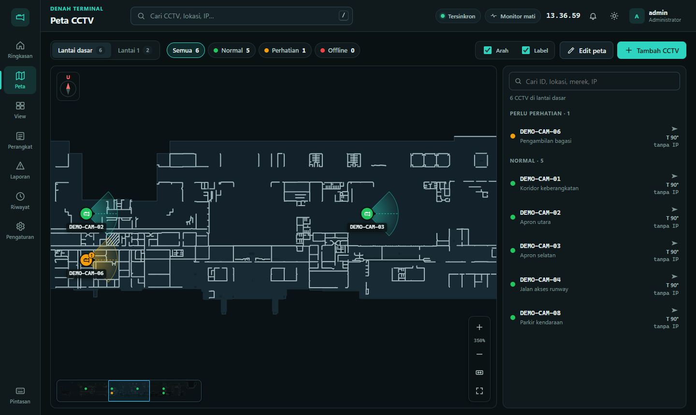
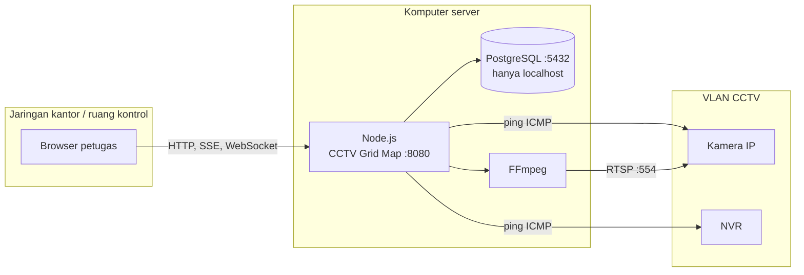

<div align="center">

# CCTV Grid Map

**Sistem web ruang kontrol untuk CCTV bandara.**
Peta posisi dan arah kamera, pemantauan ping otomatis, alarm offline, laporan gangguan, dan grid tayangan langsung dalam satu layar.


[Fitur](#fitur) · [Tampilan](#tampilan) · [Arsitektur](#arsitektur) · [Mulai cepat](#mulai-cepat) · [Konfigurasi](#konfigurasi) · [Dokumentasi](#dokumentasi)



</div>

## Fitur

| | Fitur | Keterangan |
| :---: | --- | --- |
| 📊 | **Ringkasan** | Kesehatan sistem, KPI, status per area dan lantai, tren laporan dan kejadian offline 14 hari, kualitas ping |
| 🗺️ | **Peta CCTV** | Titik, arah pandang, dan cakupan kamera di denah tiap lantai; mode edit seret-dan-putar untuk admin |
| 🖥️ | **View** | Grid tayangan langsung 1/4/9/16 atau kustom, dikelompokkan per area, rotasi otomatis, jendela terpisah untuk monitor kedua |
| 📡 | **Monitor ping** | Ping otomatis seluruh CCTV dan NVR; dua kali gagal berturut-turut = offline |
| 🔔 | **Alarm realtime** | Notifikasi dan bunyi saat CCTV offline, tersinkron ke semua komputer lewat Server-Sent Events |
| 📝 | **Laporan gangguan** | Nomor laporan otomatis, prioritas, alur Baru → Dikerjakan → Selesai |
| 🕘 | **Riwayat audit** | Setiap perubahan dan kejadian tercatat, bisa diekspor ke CSV |
| 🔐 | **Akun petugas** | Peran admin dan operator, sesi aman, URL RTSP terenkripsi AES-256-GCM |

## Tampilan

<table>
  <tr>
    <td width="50%"></td>
    <td width="50%"></td>
  </tr>
  <tr>
    <td align="center"><b>View</b>: grid tayangan langsung, bisa dibuka di jendela terpisah</td>
    <td align="center"><b>Peta</b>: posisi, arah, dan cakupan setiap kamera</td>
  </tr>
</table>

> Screenshot memakai data contoh dan pola video uji FFmpeg, bukan kamera bandara sungguhan.

## Arsitektur



- Browser **tidak pernah** terhubung langsung ke database atau kamera. Server memeriksa login, lalu mendekripsi URL RTSP hanya saat video dibutuhkan.
- Grid View memakai WebSocket ke Media Source Extensions, karena browser hanya membuka 6 koneksi HTTP per server.
- Detail lengkap ada di [docs/architecture.md](docs/architecture.md).

## Mulai cepat

### Prasyarat

| Perangkat lunak | Versi | Catatan |
| --- | --- | --- |
| Node.js | 22 atau lebih baru | |
| PostgreSQL + pgAdmin | 17 | Dengarkan `127.0.0.1` saja |
| FFmpeg | terbaru | `winget install Gyan.FFmpeg`, terdeteksi otomatis |

### Instalasi

```powershell
# 1. Ambil kode
git clone https://github.com/Naufal-Ghani22/CCTV-GridMap-Detection.git
cd CCTV-GridMap-Detection

# 2. Siapkan konfigurasi rahasia (isi semua nilainya)
copy .env.example .env

# 3. Pasang dependensi dan siapkan database
npm install
npm run db:migrate
npm run db:bootstrap

# 4. Jalankan server
npm start
```

Buka alamat LAN yang dicetak server, misalnya `http://192.168.1.10:8080`, lalu masuk dengan akun admin dari `.env`. Petugas lain cukup memakai browser; mereka tidak perlu PostgreSQL atau pgAdmin.

> [!IMPORTANT]
> Supaya ping dan tayangan berjalan, komputer server harus berada di jaringan CCTV atau punya rute ke sana. Ikuti [Deployment bandara](docs/deployment-airport.md) dan koordinasikan dengan IT bandara.

## Konfigurasi

Semua konfigurasi ada di `.env` (lihat [`.env.example`](.env.example)).

| Variabel | Wajib | Bawaan | Fungsi |
| --- | :---: | --- | --- |
| `DATABASE_URL` | ✅ | | Koneksi PostgreSQL lokal |
| `RTSP_ENCRYPTION_KEY` | ✅ | | Kunci Base64 32 byte untuk mengenkripsi URL RTSP |
| `BOOTSTRAP_ADMIN_EMAIL` | ✅ | | Email administrator pertama |
| `BOOTSTRAP_ADMIN_PASSWORD` | ✅ | | Sandi administrator pertama, minimal 12 karakter |
| `PORT` | | `8080` | Port web |
| `MONITOR_INTERVAL_SEC` | | `60` | Jeda ping otomatis (15–3600 detik) |
| `MAX_STREAMS` | | `8` | Tayangan bersamaan untuk seluruh server |
| `MAX_STREAMS_PER_USER` | | `4` | Tayangan bersamaan per pengguna; naikkan untuk grid 9 atau 16 |
| `STREAM_VIDEO_CODEC` | | transcode | Isi `copy` untuk kamera H.264 agar hemat CPU |
| `MONITOR_DISABLED` | | | Isi `1` untuk mematikan ping otomatis |

> [!CAUTION]
> `.env` berisi rahasia server. Jangan pernah memasukkannya ke Git, backup database, screenshot, atau chat.

## Perintah

| Perintah | Fungsi |
| --- | --- |
| `npm start` | Menjalankan server |
| `npm run db:migrate` | Membuat atau memperbarui struktur database |
| `npm run db:bootstrap` | Membuat administrator pertama dari `.env` |
| `npm run db:reset-admin` | Menyetel ulang akun admin dari `.env` |
| `npm test` | Tes unit dan API (memakai PostgreSQL lokal dari `.env`) |
| `npm run test:unit` | Tes unit saja, tanpa database |
| `npm run test:e2e` | Tes antarmuka di Edge/Chrome headless |
| `npm run db:smoke` | Memastikan instalasi baru masih kosong |

## Struktur proyek

```text
CCTV-GridMap-Detection/
├── server.js            # rute, kontrol akses, aset statis, start monitor
├── config.js            # membaca dan memvalidasi .env
├── index.html           # kerangka antarmuka
├── app.js               # logika antarmuka (vanilla JS)
├── styles.css           # tema gelap/terang dan tata letak
├── routes/              # handler API per domain
├── lib/                 # monitor ping, FFmpeg, WebSocket, sesi, validasi
├── db/                  # skema, migrasi, bootstrap admin
├── maps/                # denah SVG lantai dasar dan lantai 1
├── tools/               # skrip Python pembuat denah dari PDF CAD
├── tests/               # tes unit, API, dan e2e
└── docs/                # dokumentasi lengkap
```

## Dokumentasi

| Dokumen | Isi |
| --- | --- |
| [Arsitektur](docs/architecture.md) | Komponen, alur data, berkas server |
| [Instalasi Windows](docs/installation-windows.md) | PostgreSQL, `.env`, kunci enkripsi |
| [Operasi CCTV](docs/operations.md) | Peta, View, ping, laporan, pintasan keyboard |
| [Database dan pgAdmin](docs/database.md) | Tabel, backup, pemulihan |
| [API](docs/api.md) | Endpoint dan format data |
| [Keamanan](docs/security.md) | Sesi, enkripsi RTSP, batas akses |
| [Deployment bandara](docs/deployment-airport.md) | Memindahkan ke server bandara |
| [Troubleshooting](docs/troubleshooting.md) | Masalah umum dan solusinya |
| [Panduan koneksi jaringan](docs/Panduan%20Koneksi%20Jaringan%20Bandara.docx) | Panduan Word menyambungkan ke jaringan bandara |

## Kontribusi

1. Buat branch dari `main`, misalnya `feat/nama-fitur` atau `fix/nama-masalah`.
2. Jalankan `npm test` dan `npm run test:e2e` sebelum push.
3. Buka pull request ke `main` dan minta review rekan tim.

<div align="center">
<sub>Dibuat untuk ruang kontrol CCTV bandara · Antarmuka berbahasa Indonesia</sub>
</div>
